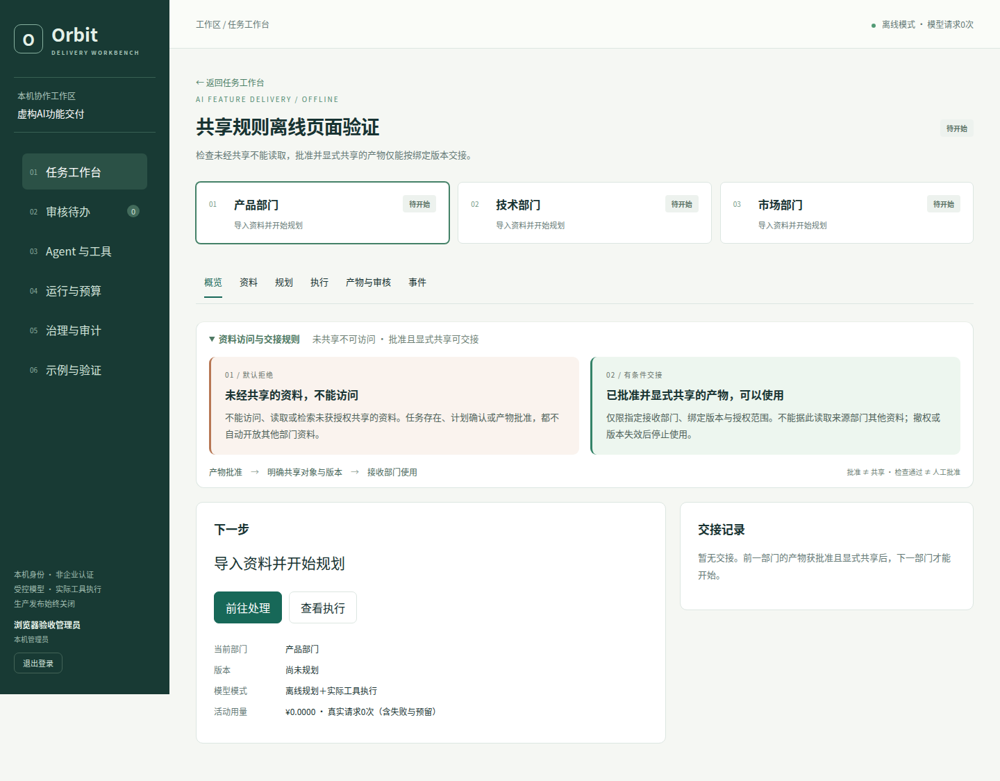

# Orbit · Agent任务编排与受控执行平台

基于既有控制平台改造的个人展示项目。以虚构“团队知识助手交付”为案例，贯通产品、技术、市场的规划、固定工具执行、显式交接、退回审核和本地交付。默认离线，无需模型密钥。

重点是执行权限、版本和失败处理：模型提出建议，宿主控制能否执行；评估通过后仍需审核；跨部门只共享获批准的明确产物版本。

## 先看案例（无需Node、数据库或模型）

环境：Ubuntu/WSL2、uv、Python3.14。项目根目录执行：

```bash
uv sync --locked
uv run --locked --offline python -m showcase.workbench.snapshot_view --port 8433
```

打开 http://127.0.0.1:8433/ ，查看市场v1/v2、退回与批准记录，下载完整交付ZIP。所需虚构快照已包含在`examples/delivery-snapshot/`，不依赖作者的私有.runtime。

**证据边界：** 产品、技术与市场v1为离线前置；市场v2是既有真实模型候选，随后在新隔离副本中完成零模型审核与交付。审核由自动化本机测试账号执行，不代表真人或生产批准。旧失败活动保持失败；查看页面不会产生模型费用。

## 从零操作完整工作台

### 1. 安装并启动

环境：Ubuntu/WSL2、Git、uv、Python 3.14、Node 24、npm 11。首次安装依赖需要包仓库网络；工作台默认离线，不需要模型账号或密钥。

先克隆仓库并进入目录；私有阶段需要相应访问权限：

```bash
git clone https://github.com/wangkejun0006/agent-control-platform.git
cd agent-control-platform
```

以下命令在仓库根目录执行：

```bash
uv sync --locked --extra loopback-d0
npm ci --prefix packages/agent-authoring-toolkit --ignore-scripts
npm ci --prefix packages/orbit-control-plane-console --ignore-scripts
npm run build --prefix packages/orbit-control-plane-console
bash scripts/run_demo.sh
```

看到 `Uvicorn running on http://127.0.0.1:8432` 后打开该地址。8432 是可操作工作台；8433 是上方只读历史案例，两者数据不同。终端需保持打开；Ctrl+C 停止服务，再运行启动命令可继续使用原数据。这里没有配置常驻或开机启动。

默认数据在 `.runtime/workbench/`。想做全新练习而保留旧案例，改用未使用的合法子目录，例如：

```bash
ORBIT_WORKBENCH_STATE_ROOT="$PWD/.runtime/workbench/practice-001" bash scripts/run_demo.sh
```

同一时刻只启动一个8432服务。之后恢复该练习时使用相同目录，不要删除数据库；新练习换一个目录名。状态根仅支持项目 `.runtime/workbench/` 下的私有目录或专用/tmp子目录，不能任意指向其他项目。

### 2. 创建账号并准备资源

首次打开填写用户名、显示名称和至少12位口令，点击“创建管理员并进入”。这是本机账号，不是企业身份认证。重启后使用原账号登录，不需要重新创建。

首页“首次使用准备清单”显示专业Agent和固定工具的激活数量：

1. 点击“前往配置Agent与工具”。
2. 点击“评价全部已登记候选”，等待显示待批准激活。
3. 点击“批准并激活全部已通过候选”，确认三个Agent和五个工具均已激活。
4. 点击“返回任务工作台”。若从某个任务进入配置，按钮为“返回原任务”；刷新配置页后仍可返回。

评价通过不会自动激活；激活也不替代每个任务的计划确认和产物审核。未就绪时提交执行按钮不可用。暂停的版本不能绕过原生命周期一键恢复，演示时不要随意暂停。

### 3. 新建任务和导入资料

1. 点击“＋ 创建交付任务”，首次练习保留默认目标和“正常交付”场景，填写任务标题后点击“创建任务”。
2. 在概览点击“前往处理”，进入“资料”页。
3. 点击“导入13份虚构资料并授权三部门使用”，等待资料列表出现 `requirements-v2.md`。
4. 可点击资料查看版本、原文行号和不可信指令提示。导入会分别授权三部门使用虚构基础资料，不代表部门产物已经互相共享。

首轮请使用内置资料。自有资料仅支持UTF-8的txt/md/csv/json、单份不超过256KiB；PDF/DOCX暂不解析。上传成功不代表已做恶意内容扫描。已开始规划的快照不能原地覆盖。

### 4. 产品规划、执行、审核和交接

按下面顺序完成一个部门，技术和市场复用同样流程：

| 页面 | 点击或填写 | 预期结果 |
|---|---|---|
| 规划 | 点击“开始部门规划” | 出现澄清问题卡 |
| 规划 | 核对推荐选项，可补充约束，点击“提交回答并生成计划” | 出现待确认任务包 |
| 规划 | 填写至少8字计划审核说明，如“已核对资料、权限和固定工具范围，同意本机离线执行。”；点击“确认计划与工具范围” | 状态为计划已确认 |
| 规划 | 点击“提交受控执行” | 任务进入队列，不再需要运行额外脚本 |
| 执行 | 查看五个工具回执 | 五项均显示已执行；执行状态为执行已完成，任务进入待审核 |
| 产物与审核 | 阅读业务正文、引用及检查；必要时展开完整产物 | 检查通过仍需人工决定 |
| 产物与审核 | 填写审核说明，如“已核对引用、权限和限制，批准当前虚构演示版本。”；点击“批准并授权交接技术部门” | 显示交接已完成、版本和接收部门 |
| 产物与审核 | 点击“进入技术部门继续” | 进入技术部门当前可操作页面，不会自动启动规划 |

未共享资料不能访问；只有已批准且显式共享的产物才能按接收部门、版本和范围交接。仅批准但未交接时，下一部门仍需等待。切换顶部部门卡片可查看该部门当前阶段；没有生成候选时不会显示v0。

技术部门完成后点击“批准并授权交接市场部门”，再点“进入市场部门继续”。市场最后点击“批准本部门产物”。本机管理员在本演示中依次承担负责人操作，不是三个真人部门协同的证明。

### 5. 在市场部门演示一次退回与修订

在市场v1生成、尚未批准时：

1. 在“审核或修订说明”填写：**请补充资料不足时的处理步骤，并给出负责人可逐项核对的验收清单。**
2. 点击“退回修改”。确认出现退回意见和需返工状态。
3. 勾选“我已核查旧尝试；新建修订不会盲目重放不确定步骤。”，点击“创建新修订并重新规划”。
4. 在规划页阅读“本轮返工意见”，再次提交澄清回答、填写计划说明、确认计划并提交执行。
5. 打开“产物与审核”，核对v2新增的缺证处理步骤、负责人验收清单及“返工要求逐项核对”。
6. 查看“返工版本差异”中的新增/删除行；如需核查原文，展开“对照上一版本”和“全部尝试与历史候选”。这些视图不修改旧记录。
7. 确认要求已落实后，填写审核说明并点击“批准本部门产物”。

离线返工是有界模板：支持缺证处理步骤、验收清单、范围与证据边界、三态决策表、交接清单。比如提出“新增短信通知功能”，会显示未解决并阻断批准；不能把模板当作通用自然语言理解。检查PASS也不能替代人工核查。

### 6. 最终审核和ZIP交付

三个部门当前版本均获批准后：

1. 管理员打开“审核待办”，点击“最终交付审核”卡片；或在任务概览点击“前往处理”。
2. 核对当前版本、交接和返工结果，填写至少8字最终说明，如“已核对三部门当前版本和证据，仅批准本机虚构演示交付。”
3. 点击“批准本地交付”，再点击“下载交付包 ZIP”。待办应归零，刷新后仍可下载。
4. 解压后先读 `product_center.md`、`technology_center.md`、`market_center.md`；再查各部门 `*-evidence.json` 中的引用和实际工具回执，最后查 `review-records.json` 与 `delivery.json`。

此批准只生成本地文件，不对外发布。最终审核仅限管理员；部门负责人不能替代最终批准。默认离线模式下三个部门的模型请求应为0。

### 常见卡点

| 现象 | 处理 |
|---|---|
| 页面打不开或启动提示端口占用 | 确认终端服务仍在运行、8432没有被另一实例占用；不要删除旧数据解决端口问题 |
| 提示先构建控制台 | 按第1步安装依赖并运行前端build，再启动 |
| 执行按钮不可用 | 查看准备清单，完成Agent和工具激活；确认计划已经批准 |
| 下一部门等待交接 | 返回上一部门，先批准当前候选并显式交接；旧版本交接不能代替当前版本 |
| 检查失败或返工未解决 | 查看失败项和原意见，补资料或细化要求后创建新修订；不要将失败改成通过 |
| 执行失败、取消或结果不确定 | 保留失败记录，核对旧尝试和工具回执后再明确创建修订；不要盲目重复执行 |
| 重启后出现初始化页面 | 核对是否用了不同状态目录，恢复原启动目录；不要覆盖旧账号库 |
| 退出WSL或关闭终端后服务停止 | 重新运行原启动命令；本项目默认不是常驻服务 |

## 核心能力

| 能力 | 实现与验证边界 |
|---|---|
| 规划与执行分离 | 原LangGraph澄清/任务包/确认，原Router与RuntimeComposer控制固定专业任务 |
| 受控实际工具 | 原SQL队列、签名Grant、单Worker和租约；工具在独立进程实际执行，不支持任意Shell或代码 |
| 跨部门交接 | 批准不等于共享，只允许目标部门、绑定版本和授权范围消费指定产物 |
| 返工与审核 | 精确候选摘要/版本批准、旧版拒绝、下游失效、幂等请求和历史保留 |
| 证据与预算 | 原Evaluator与来源门禁；可选模型统一预留，失败计数，默认不授权消费 |
| 生命周期与治理 | 固定Agent/Tool候选的登记、评价、批准、暂停，保留模型路线与审计入口 |

[架构与继承/新增划分](docs/ARCHITECTURE.md) · [五分钟演示](docs/DEMO_CURRENT.md) · [测试与干净环境验证](docs/VALIDATION.md)



## 验证

```bash
uv run --locked --offline python scripts/validate_offline.py \
  --report .runtime/check-001/report.json --log .runtime/check-001/tests.log
```

报告路径必须全新。前端类型、单元、构建和浏览器命令见[验证文档](docs/VALIDATION.md)；E2E需要8432端口空闲。验证区分当前便携范围与依赖原领域/设备的排除项，不能声称原全量全部通过。仓库提供离线GitHub Actions；历史发布候选的远端验证与未推送的本地修改须分别核对，不能把旧CI结果算作新修改的远端验证。

本次在白名单导出的新目录、新虚拟环境与新node_modules中完成安装和运行验证，未携带作者私有运行资料；共享了本机包缓存与浏览器。结果、跳过范围和未验证项见[发布候选检查报告](reports/release-readiness-20261017.json)。

历史模型失败、修复与审核记录保留，索引见[收尾前开发记录](docs/history/README-before-release-closeout-20261017.md)。当前真实模型传输仍为可选显式授权适配，不是默认开箱调用；本机兼容配置及预算边界见[模型配置](docs/MODEL_CONFIGURATION.md)。

## 能力边界

SQLite单Worker、本机Cookie身份、固定工具及有界中文检查；不是强OS沙箱、通用事实核验或生产高可用系统。Hermes/Codex Runtime、真实OIDC、Postgres多Worker和生产部署未验收。自然语言与检查PASS不能替代授权或人工判断。

## 来源与许可

MIT。项目所有者已确认公开范围；代码来源、继承能力、个人后续改造和第三方依赖边界见[NOTICE](NOTICE.md)。发布白名单为`release/manifest.json`；导出工具不包含私有运行目录、账号库、私钥、缓存或原Git历史，也不执行推送。
