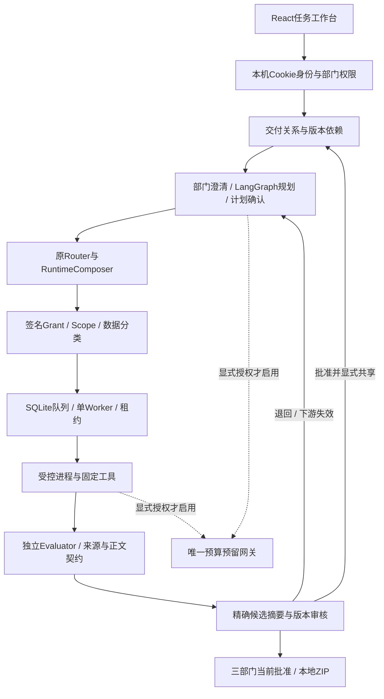

# 架构与能力边界

DeliveryWorkflow关联部门任务、依赖和共享产物；原任务、队列、Grant、租约、评价和审核对象保持各自权威。工作流父子关系不授予资料权限，只有批准且显式共享的指定产物版本可交接。计划确认不是结果批准，评价PASS不是发布授权。

默认规划和专业决策为离线确定性端口，工具真实运行。可选真实模型仅在显式授权Campaign存在时运行，先预留再取凭据和请求，失败计数、无自动重试。本轮发布收尾不创建Campaign。

| 来源 | 能力 |
|---|---|
| 继承实现 | Router、Evaluator、数据分类、Agent/Tool生命周期、RuntimeComposer、Grant、受控进程、SQL队列及租约 |
| 后续整合改造 | 跨部门交付工作台、虚构资料、实际工具适配、预算统一、返工与来源门禁、公开只读案例 |
| 未验收 | Hermes/Codex Runtime、真实OIDC、OS强沙箱、Postgres多Worker、生产发布和跨机器高可用 |

只读案例入口单独读取examples/delivery-snapshot，不打开工作台数据库，不初始化模型/身份/Worker。它用于看既有结果，不能代替操作完整工作台或新的模型验证。
