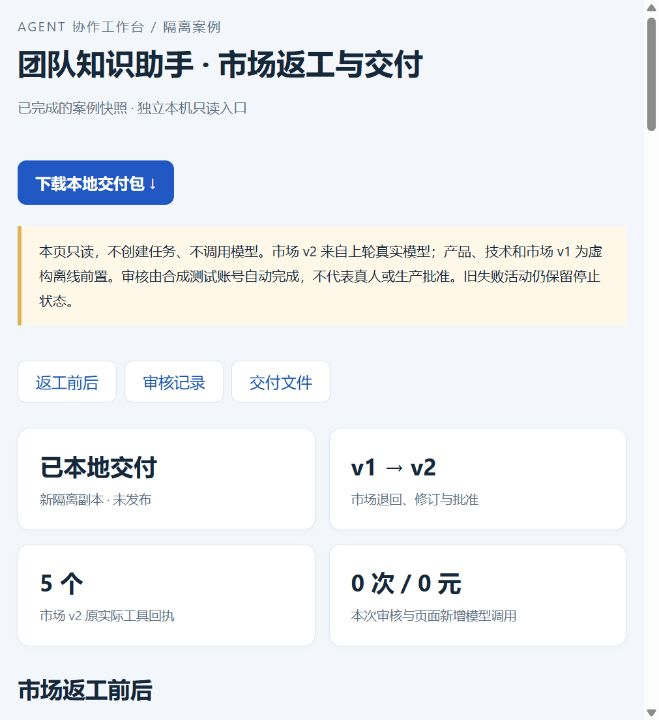
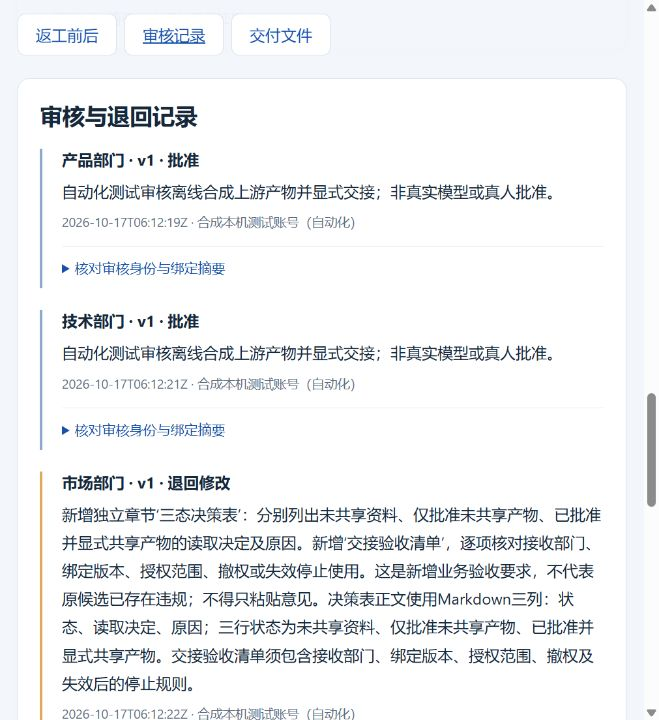

# 面试演示：从返工到可追溯交付

## 五分钟查看

1. 在项目根目录启动`uv run --locked --offline python -m showcase.workbench.snapshot_view --port 8433`，说明这是只读快照，不在后台调用模型。
2. 打开“返工前后”，解释市场v1为离线初稿。退回要求新增三态决策表与交接清单，v2为此前真实模型候选；没有用新生成内容替换旧失败响应。
3. 对照三态表：未共享资料拒绝、仅批准未共享产物拒绝、批准且显式共享的产物按目标部门/版本/Scope允许。展开来源定位，说明正文检查不能代替访问授权。
4. 打开“审核记录”，展示v1退回和v2精确摘要批准；讲解旧版批准409、重复请求幂等。明确审核是自动化本机测试账号，不是用户真人签署。
5. 下载本地ZIP，展示三部门正文、实际工具回执、引用和审核记录。说明该新隔离副本完成交付，不把之前失败活动改成成功。

## 完整工作台操作

通过README的8432入口，从首次账号、候选评价/批准激活、任务创建和13份虚构资料导入开始。依次完成产品规划确认、实际执行、审核和显式交接；技术、市场同样执行。在市场审核退回，补充三态表要求后重新规划、执行、审核，最后本地交付。所有默认决策为离线模式，工具确实运行，阶段状态不能冒充新LLM结果。

## 三个值得追问的技术点

- 模型的工具意图为何不能直接成为执行授权：Router、能力、Scope、Grant、队列和工具契约各自检查。
- 上游版本变化后为何不能复用旧批准：候选摘要、版本和下游依赖失效链绑定。
- 不确定执行结果为何不能盲目重试：租约、中断记录、幂等键和明确的新尝试，避免重复副作用。

## 失败案例

历史规划曾照抄尚未检索的证据编号，结构正确仍被来源门禁拒绝；后续真实候选使用“不读取”被狭窄驱动词表误拒。修复通过离线正/反例回归验证，原失败记录继续保留。新隔离审核使用既有v2完成，新增模型调用为0；不能把规则检查通过说成模型全文正确。

旧库存演示见DEMO.md，早期功能映射见FEATURE_PARITY.md；它们是历史/回归材料，不替代本页主线。

## 页面材料

下面为既有零模型审核与本地交付案例截图，不是本轮新模型调用。

